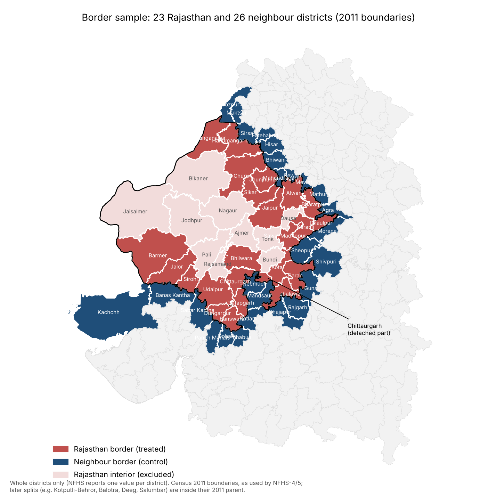

# Rajasthan's state health insurance (BSBY) and welfare: a border-district DiD

**Main study.** Rajasthan launched the Bhamashah Swasthya Bima Yojana (BSBY) on
13 Dec 2015 (merged into AB-MGRSBY with Ayushman Bharat in 2019). Neighbouring
states had RSBY and then PM-JAY. We compare Rajasthan's border districts with the
districts directly across the state line, NFHS-4 (2015-16) → NFHS-5 (2019-21),
following Dube, Lester & Reich (2010).



## Design

- **Sample:** 51 contiguous Rajasthan–neighbour district pairs from the Census
  2011 map (`code/06a_border_pairs.py`). 23 Rajasthan and 26 neighbour districts;
  every pair shares ≥ 7 km of border. 40 pairs are used: 5 neighbour districts
  split after NFHS-4 (Panchmahal, Sabarkantha, Bhiwani, Shajapur, Firozpur) have
  no comparable NFHS-4 value.
- **Specification:** ΔY_ip = β·Rajasthan_i + pair FE, i.e. a within-pair DiD.
  SEs are two-way clustered by Rajasthan district and neighbour district.
- **Pre-trend:** three-round state event study (NFHS-3 → 4 → 5) with Karan et
  al. (2017) notation: φ2 = pre-period DiD, φ3 = post-period DiD. Permutation
  inference across states (Abadie et al. 2010).
- **Baseline caveat:** Rajasthan's NFHS-4 fieldwork ran 23 Jan – 21 Jul 2016,
  after launch. Early enrolment inflates the baseline, so β is a lower bound.

## Results (`code/06_insurance_border.py`)

| Outcome (border-pair DiD; SE in brackets; insurance p<0.001 in all) | All borders | Drop Gujarat | MP only | Pairs ≥10 km |
|---|---|---|---|---|
| Insurance coverage (pp) | **+52.8 (5.1)** | +51.2 (5.5) | +45.4 (6.2) | +52.0 (5.0) |
| OOP per delivery, public facility (Rs) | −253 (702) | −268 | −840 (1055) | −294 |
| log OOP | −0.08 (0.31) | −0.08 | −0.28 | −0.10 |
| Institutional births (pp) | −1.2 (2.3) | −2.1 | −2.2 | −1.5 |
| Placebo: electricity (pp) | +3.2 (3.5) | +1.7 | +1.9 | +3.2 |
| Placebo: women 10+ yrs school (pp) | +3.1 (1.7), p=0.08 | +2.5 | +0.3 | +2.6 |

State event study (insurance coverage): Rajasthan 4.5% → 18.7% → **87.8%**.
Against its five neighbours, the pre-trend DiD is φ2 = +4.1 pp and the post DiD is
φ3 = +56.4 pp. Rajasthan's post-period jump ranks 1st of 26 states (permutation
p = 0.04).

**Reading:** The scheme moved coverage enormously, and the result is robust to
every sample. Out-of-pocket spending on deliveries falls in point estimate but
imprecisely. This matches Karan, Yip & Mahal (2017), who find RSBY did not
reduce OOP. Deliveries are a narrow window on financial protection, since
public-facility deliveries are already near-free under JSY.

## Run

```bash
pip install pandas statsmodels linearmodels matplotlib geopandas
python code/06a_border_pairs.py      # pairs + map (needs geopandas)
python code/06_insurance_border.py   # border DiD, placebo, state event study
```

---

# Appendix: earlier PMUY analysis

## Welfare analysis of PM Ujjwala Yojana (PMUY) in Rajasthan: evidence from NFHS-4 and NFHS-5

Class project. PMUY (May 2016) gave free LPG connections to poor households:
63.59 lakh in Rajasthan by March 2021, 8 crore nationally by Sept 2019. NFHS-4
(2015-16) was collected just before launch and NFHS-5 (2019-21) after.

**Question:** How much did PMUY move Rajasthan households onto clean cooking fuel,
did Rajasthan lag the rest of India, and is the scheme welfare-improving in
Rajasthan once costs (including the state's Rs 450 refill top-up) are counted?

## Why Rajasthan needs the national data

Within Rajasthan alone (33 districts), the intensity DiD has **no first stage**
(slope 0.06, p = 0.64, F ≈ 0.2). Every district gained about the same, whatever
its baseline. So the design is:

1. **Identification from all-India** (575 districts, state FE): the causal
   slope of LPG uptake on PMUY exposure (`code/02_pmuy_did.py`).
2. **Rajasthan vs comparable districts** (`code/05_rajasthan_gap.py`): did
   Rajasthan districts gain less than districts elsewhere with the same baseline
   exposure, electricity, sanitation, water and schooling?
3. **Rajasthan welfare calibration** (`code/04_cba.py Rajasthan`): conversion
   rate and CBA/MVPF using Rajasthan connections, households and the state top-up.

## Results

| | Estimate | Inference |
|---|---|---|
| All-India first stage (Δ clean fuel per 1 pp exposure) | 0.16 | p = 0.003 |
| All-India quadratic: peak effect at ~67% baseline non-use | 0.67 / −0.50 | p < 0.001 |
| Within-Rajasthan first stage | 0.06 | p = 0.64 (not identified) |
| Rajasthan mean Δ clean fuel vs rest of India | +9.5 vs +16.4 pp | |
| **Rajasthan gap vs comparable districts** | **−8.2 pp** | cluster p < 0.001; permutation: 2nd worst of 24 states, p = 0.25 |
| Health 2SLS (child ARI, stunting, underweight, anaemia; women anaemia) | null | all p > 0.3 |
| Placebo (institutional births) | null | p = 0.21 |

**Rajasthan welfare:**
- **Conversion:** 7–26% of Rajasthan's PMUY connections became households using
  clean fuel as main fuel. That's Rs 6,100–21,800 of connection subsidy per
  effective switcher (the national figure is ~37%).
- **Per beneficiary household (10 yrs, 8%):** social NPV ≈ Rs 21,700 and MVPF ≈ 2.8
  with the state top-up, under the base assumptions (time valued at 50% of the
  wage, 3.95 refills/yr, health = 0). At 25% of the wage, NPV is negative.
- The Rs 450 refill scheme (Jan 2024) comes **after** NFHS-5, so this study cannot
  evaluate it. It enters only the government-cost side of the CBA.

### Run (PMUY)

```bash
pip install pandas statsmodels linearmodels matplotlib
python code/01_build_panel.py
python code/02_pmuy_did.py              # all-India -> output/all_india/
python code/02_pmuy_did.py Rajasthan    # within-state check -> output/rajasthan/
python code/05_rajasthan_gap.py         # Rajasthan vs comparable districts
python code/04_cba.py                   # all-India CBA
python code/04_cba.py Rajasthan         # Rajasthan CBA
```

`code/03_bihar_prohibition.py` is the abandoned alternative topic (state-level
null result), kept for reference.

## Data (`data/raw/`)

- `nfhs_districts_641_kalla.csv`: NFHS-4 and NFHS-5 district factsheets, 641
  districts ([SaiSiddhardhaKalla/NFHS](https://github.com/SaiSiddhardhaKalla/NFHS)).
  Values cross-checked against the pratapvardhan file.
- `nfhs5_districts_with_nfhs4.csv`, `nfhs5_states_with_nfhs4.csv`: [pratapvardhan/NFHS-5](https://github.com/pratapvardhan/NFHS-5)
- `nfhs4_states_ht.csv`: [HindustanTimesLabs/nfhs-data](https://github.com/HindustanTimesLabs/nfhs-data)

## CBA parameters to verify before submission (`code/04_cba.py`)

| Parameter | Value | Source | Status |
|---|---|---|---|
| Connection assistance | Rs 1,600 | pmuy.gov.in | verified |
| Refills / beneficiary / yr | 3.95 (FY24) | Rajya Sabha reply, Feb 2025 | verified |
| Refill subsidy | Rs 300 | MoPNG, Oct 2023 | check |
| Rajasthan PMUY connections | 63.59 lakh (31.03.2021) | Lok Sabha AU1844 | verified |
| Rajasthan households | 1.45 crore | **assumption** (Census 2011 ≈ 1.26 cr, grown) | replace |
| Rajasthan refill price to PMUY | Rs 450 from Jan 2024 | CM announcement, Dec 2023 | check |
| LPG unsubsidised price | Rs 850 | IOCL Delhi price | check |
| Firewood collection hours | 660 / household / yr | Practical Action (2015) | check original |
| Rural female wage | Rs 300/day | **assumption**; replace with PLFS / Labour Bureau | replace |
| Stove cost | Rs 1,000 | **assumption** | replace |
| Full-LPG refills / yr | 7 | **assumption** | replace |

## Limitations

- Exposure correlates with poverty. State FE, baseline controls and the placebo
  help but don't fully rule out differential trends. With only two rounds there
  is no pre-trend test.
- The first stage is borderline weak for 2SLS (clustered F ≈ 9), and is
  not identified within Rajasthan alone.
- The Rajasthan gap is conditional on observables. Part of it may come from
  non-PMUY factors (e.g. firewood availability in desert districts), so the
  conversion lower bound attributes all of it to PMUY, which is an extreme case.
- The level effect behind the conversion rate needs the "zero exposure → zero
  effect" assumption.
- Factsheet data is district averages. Household-level NFHS microdata (DHS
  registration) would allow a stronger design.
