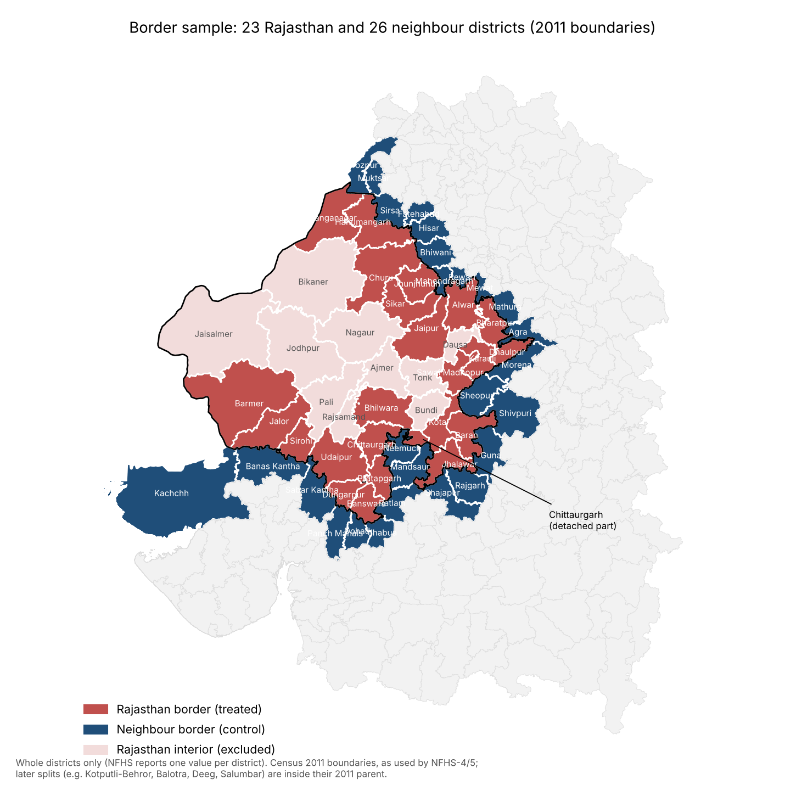
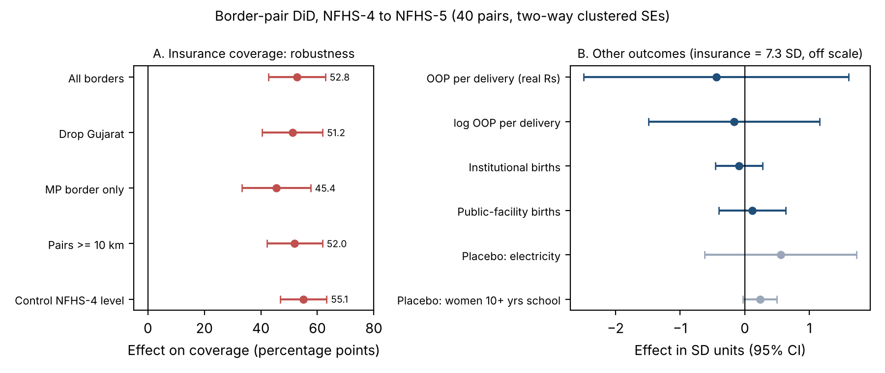
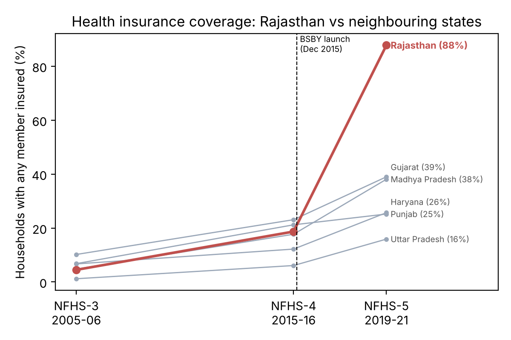
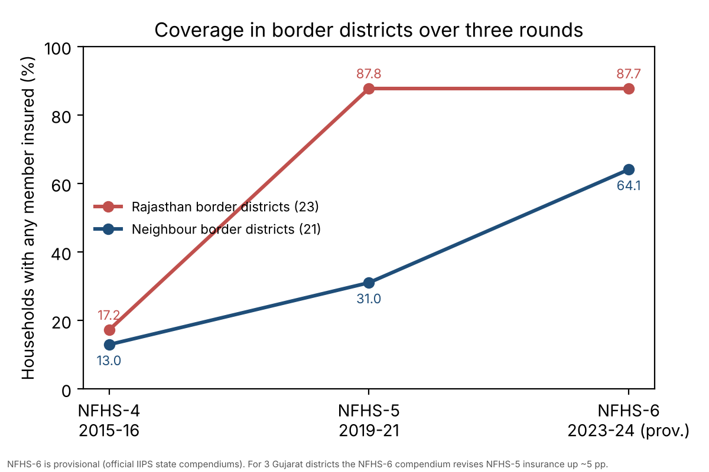
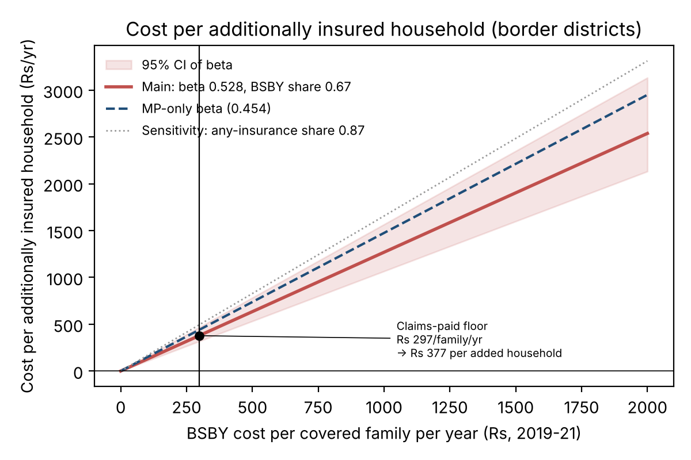

# Rajasthan's state health insurance and household welfare: a border-district difference-in-differences

**A complete explainer of the project: background, literature, data, methods, results and conclusions**

Every number in this document comes from the final pipeline (`./run_all.sh`), which
runs only on cleaned data and stops unless the data audit passes. Repository:
<https://github.com/ipsanmoljj/india-welfare-analysis>

---

[TOC]

## Contents

1. [The project in one page](#1-the-project-in-one-page)
2. [Background: why health insurance for the poor matters in India](#2-background-why-health-insurance-for-the-poor-matters-in-india)
3. [Literature review](#3-literature-review)
4. [Research question and hypotheses](#4-research-question-and-hypotheses)
5. [The policy: Bhamashah Swasthya Bima Yojana](#5-the-policy-bhamashah-swasthya-bima-yojana)
6. [Data](#6-data)
7. [Data cleaning and quality checks](#7-data-cleaning-and-quality-checks)
8. [Building the border sample](#8-building-the-border-sample)
9. [Empirical strategy](#9-empirical-strategy)
10. [Results](#10-results)
11. [Cost-effectiveness and break-even](#11-cost-effectiveness-and-break-even)
12. [Discussion: what the results mean against the literature](#12-discussion-what-the-results-mean-against-the-literature)
13. [Conclusions](#13-conclusions)
14. [Limitations and future work](#14-limitations-and-future-work)
15. [Suggested slide structure](#15-suggested-slide-structure)
16. [Glossary](#16-glossary)
17. [References](#17-references)

---

## 1. The project in one page

| | |
|---|---|
| **Title** | Rajasthan's state health insurance scheme and household welfare: a border-district difference-in-differences |
| **Policy** | Bhamashah Swasthya Bima Yojana (BSBY), launched 13 December 2015: cashless hospital insurance for about 1 crore poor families in Rajasthan |
| **Question** | Did BSBY raise health insurance coverage and reduce out-of-pocket (OOP) health spending, compared with districts just across the state border that had only the national schemes? |
| **Data** | National Family Health Survey (NFHS) rounds 3, 4, 5 and 6; Census 2011 district map; official BSBY claims data |
| **Method** | Contiguous border-pair difference-in-differences (40 pairs of districts touching across the Rajasthan border), plus a three-round state event study to test pre-trends |
| **Main finding** | Insurance coverage rose **52.8 percentage points** more in Rajasthan's border districts than across the border by 2019–21 (p < 0.001), robust to every check. By 2023–24 the neighbours had partly caught up, and the gap was **+15 pp** |
| **Welfare finding** | **No detectable change in OOP spending per delivery.** The design is underpowered for this outcome, so this is not evidence of no effect |
| **Cost** | At least about **₹377 per additionally insured household per year** (cost-effectiveness, lower bound) |
| **Takeaway** | BSBY brought near-universal coverage to Rajasthan years before its neighbours; this data cannot show that it reduced what they paid |

---

## 2. Background: why health insurance for the poor matters in India

- **High out-of-pocket spending.** In India a large share of health spending is
  paid directly by households at the point of care. One hospitalisation can push
  a poor family into debt or poverty.
- **The policy response: tax-funded hospital insurance.** Governments pay an
  insurer a premium per enrolled family. The family gets cashless treatment up to
  a cover limit at empanelled public and private hospitals.
  - **Nationally:** Rashtriya Swasthya Bima Yojana (RSBY), from 2008, with ₹30,000
    of cover per family. It was replaced by Pradhan Mantri Jan Arogya Yojana
    (PM-JAY, part of Ayushman Bharat) in 2018.
  - **State schemes:** Andhra Pradesh, Karnataka, Maharashtra, Tamil Nadu and
    Gujarat launched their own, larger schemes.
  - **Rajasthan:** BSBY in December 2015, covering both secondary and tertiary
    care (₹30,000 general and ₹3 lakh critical illness per family per year).
- **The open question.** Enrolment in these schemes is large, but evidence on
  whether they reduce the financial burden is mixed. The national RSBY did not
  reduce OOP (Karan et al. 2017), while Karnataka's tertiary-care scheme reduced
  OOP and mortality (Sood et al. 2014). BSBY had not been evaluated against a
  credible comparison group.

---

## 3. Literature review

The literature falls into three groups:

1. **Method papers:** how to compare places on either side of a policy border, and
   how to do inference with one treated state.
2. **Topic papers:** the evidence on government health insurance in India.
3. **Welfare papers:** how to put costs and benefits on such schemes.

The three papers we rely on most are reviewed in full (3.1–3.3). The rest follow
more briefly (3.4).

### 3.1 Dube, Lester & Reich (2010): the method paper

*"Minimum Wage Effects Across State Borders: Estimates Using Contiguous Counties."*
Review of Economics and Statistics, 92(4), 945–964.

**Introduction.** US research on minimum wages split into two camps:
- **National panel studies** use all differences in minimum wages across states
  over time. They often found that higher minimum wages reduce employment.
- **Local case studies** compare neighbouring areas (e.g. Card & Krueger's New
  Jersey vs Pennsylvania). They usually found little or no job loss.

The authors argue that the two camps disagree because national studies compare
places that differ in many unobserved ways.

**Objective.** To estimate minimum-wage effects using only comparisons between
**counties that touch each other across a state border**, and to show why
national estimates are biased.

**Methods.**
- **Data:** county-level restaurant earnings and employment from the Quarterly
  Census of Employment and Wages, 1990–2006, covering 66 quarters.
- **Sample:** all contiguous county pairs straddling a state border, about 316
  pairs from 504 border counties.
- **Specification:** county fixed effects plus **pair-specific time effects**,
  so each county is compared only with its neighbour across the border in the
  same period.
- **Inference:** standard errors clustered on state and on border segment,
  because a county can appear in several pairs.
- **Benchmark:** traditional national specifications (county and time fixed
  effects only).

**Results.**
- **Earnings:** strong positive effects of the minimum wage, with elasticities of
  0.15–0.23 in all specifications.
- **Employment:** the traditional national specification gives significant
  negative elasticities (about −0.18 to −0.21). The contiguous-pair
  specification gives about zero (0.016). It rules out effects more negative
  than −0.15 at the 90% level.
- **Why national studies differ:** in the national specification, employment
  was already falling *before* minimum-wage increases, so the national estimates
  pick up spatial differences in trends. The contiguous pairs show no such
  pre-trends.

**Why it matters for us.** This is our design: we pair each Rajasthan border
district with the districts touching it across the line, include pair fixed
effects, and cluster to handle districts that appear in several pairs.

### 3.2 Karan, Yip & Mahal (2017): the topic paper

*"Extending health insurance to the poor in India: An impact evaluation of
Rashtriya Swasthya Bima Yojana on out of pocket spending for healthcare."*
Social Science & Medicine, 181, 83–92.

**Introduction.** RSBY, launched in 2008, covered about 4 crore families by
2016 with ₹30,000 of hospital cover. Earlier studies mostly looked only at
enrolled families with no comparison group, so they couldn't identify the
scheme's effect.

**Objective.** To estimate RSBY's causal effect on household OOP spending
(inpatient, outpatient, catastrophic) and on non-medical spending.

**Methods.**
- **Data:** three rounds of the National Sample Survey consumer expenditure
  survey: 1999–2000 and 2004–05 (pre-RSBY) and 2011–12 (post), about 3.5 lakh
  households in total.
- **Treatment:** the poorest two expenditure quintiles in districts that joined
  RSBY. Two treatment groups: early joiners (by March 2010) and late joiners.
- **Comparison:** the poorest two quintiles in districts that hadn't joined.
- **Matching:** districts matched on propensity scores to make treatment and
  comparison districts similar.
- **Specification:** difference-in-differences with state fixed effects. **Two
  pre-periods** let them test parallel trends: a pre-period DiD (φ2) should be
  zero, and the post-period DiD (φ3) gives the effect.
- **Exclusions:** states with their own schemes (Andhra Pradesh, Karnataka,
  Tamil Nadu) were dropped.
- **Notes:** the paper also observes (p. 84) that Rajasthan was still in the
  early stages of RSBY rollout as of September 2016. Table 1 (p. 85) gives an
  average premium of about ₹560 per family.

**Results.**
- **Inpatient OOP:** no effect on the likelihood of spending, the level of
  spending, or catastrophic spending.
- **Outpatient OOP:** no significant effect.
- **Any OOP:** the probability of incurring any OOP **rose by about 30%**.
- **Non-medical spending:** rose about 5%.
- **Conclusion:** RSBY was ineffective in reducing the OOP burden on poor
  households.

**Why it matters for us.**
- **It describes our comparison group:** RSBY was the scheme the neighbouring
  states had.
- **It's the benchmark for our OOP result:** a null result is what the best
  national evidence also found.
- **We use its tools:** the φ2/φ3 pre-trend notation, the rule of excluding
  states with their own schemes (we drop Gujarat as a robustness check), the
  RSBY premium, and the Rajasthan rollout observation.

### 3.3 Sood, Bendavid, Mukherji, Wagner, Nagpal & Mullen (2014): topic and method together

*"Government health insurance for people below poverty line in India:
quasi-experimental evaluation of insurance and health outcomes."* BMJ, 349, g5114.

**Introduction.** Karnataka's Vajpayee Arogyashree scheme (2010) gave
below-poverty-line (BPL) households free tertiary care (cardiac, cancer, burns,
neurological and similar) at empanelled hospitals. It required no enrolment or
premium. It was rolled out first in the northern districts, and statewide only
in August 2012.

**Objective.** To estimate the scheme's effect on OOP spending, hospital use and
mortality among BPL households.

**Methods.**
- **Design:** geographic regression discontinuity, using the boundary between
  early (eligible) and late (not yet eligible) districts.
- **Sample:** 572 villages on either side of the boundary, matched on census
  characteristics with propensity scores. About 31,500 households in eligible
  villages and 28,600 in ineligible villages.
- **Data:** a household survey in September 2012, with deaths and
  hospitalisations in the past year verified against hospital records where
  possible.
- **Placebos:** above-poverty-line households (not eligible on either side), and
  conditions not covered by the scheme.
- **Inference:** standard errors clustered at village level, and checked at
  district level.

**Results.**
- **Mortality:** deaths from conditions covered by the scheme were 0.32% among
  eligible BPL households vs 0.90% among ineligible ones, a 64% reduction.
  Above-poverty-line households showed no difference, so the placebo passes.
- **OOP:** spending on covered tertiary admissions was **64% lower**.
- **Utilisation:** tertiary-care use was 44% higher, but only borderline
  significant (p = 0.06).
- **Conclusion:** insurance for efficacious but costly, underused care can
  improve population health.

**Why it matters for us.**
- **Closest to our study in topic and method:** an Indian state's own scheme,
  evaluated with a geographic boundary.
- **Its placebo logic** (outcomes or groups that shouldn't respond) is the model
  for our placebo outcomes.
- **Its village-level design** is what we'd need for a true spatial RD, which is
  our main future-work item.
- **Its results set the upper end** of what insurance can achieve. That's useful
  for judging our break-even.

### 3.4 Other literature we drew on

| Paper | Introduction and objective | Method | Main result | How we use it |
|---|---|---|---|---|
| **Card & Krueger (1994)**, *American Economic Review* | Does a state minimum-wage rise cost jobs? New Jersey raised its minimum wage in 1992; neighbouring Pennsylvania didn't | Before-and-after survey of fast-food restaurants in both states: a cross-border DiD | No evidence of job losses in New Jersey relative to Pennsylvania | The classic precedent for a one-state-vs-neighbour DiD |
| **Abadie, Diamond & Hainmueller (2010)**, *JASA* | How to evaluate a policy in a single state (California's 1988 tobacco-control programme) when no single state is a good control | **Synthetic control**: a weighted combination of other states that tracks California before the policy; inference by **placebo permutation** across states | Cigarette consumption fell substantially relative to synthetic California; California's gap is extreme among placebo states | Our state-level inference: each state is "treated" in turn, and Rajasthan ranks 1st of 27 |
| **Conley & Taber (2011)**, *REStat* | Standard errors in DiD with very few treated units are unreliable | Inference based on the distribution of control-group residuals; application to a state merit-scholarship programme | Conventional standard errors can badly overstate precision when only a few groups are treated | Why we use permutation, not regression standard errors, at state level |
| **Dupas & Jain (2021, rev. 2023)**, NBER Working Paper 28972 | Do men and women benefit equally from government insurance? | Analysis of about 4.2 million BSBY hospital visits from Rajasthan's administrative claims | Women are under-represented in BSBY hospital visits relative to their population share, especially girls and older women | The same scheme, a different question: who *uses* BSBY, not its effect. Working paper |
| **Kling, Liebman & Katz (2007)**, *Econometrica* | Effects of moving to lower-poverty neighbourhoods (the Moving to Opportunity experiment) | Randomised housing vouchers; outcomes summarised as **standardised effect sizes** | Large mental-health gains for adults; mixed effects for youth | The convention behind our z-score (SD-unit) column |
| **Dell (2010)**, *Econometrica* | Long-run effects of colonial forced labour (the Peruvian *mita*) | **Spatial regression discontinuity** at the historical mita boundary, using household locations | Lower household consumption and higher child stunting inside the former mita area today | The reference for a spatial RD, which we can't do with district averages (future work) |
| **Dhaliwal, Duflo, Glennerster & Tulloch (2013)**, J-PAL | How to compare value for money across development programmes | **Cost-effectiveness analysis**: programme cost ÷ causal impact from evaluations, with standardised cost accounting | Programmes differ by orders of magnitude in cost per unit of impact | The template for our cost per additionally insured household |
| **Finkelstein & McKnight (2008)**, *Journal of Public Economics* | What was Medicare's welfare value? | Valuing the reduction in OOP **risk**, not just average spending | The value of risk protection covers a substantial share of the programme's cost | Tier-3 welfare method (needs household-level data) |
| **Hendren & Sprung-Keyser (2020)**, *QJE* | Comparing policies by welfare per rupee spent | **MVPF**: beneficiaries' willingness to pay ÷ net cost to government, for 133 US policies | Direct investments in children often have the highest MVPFs | Tier-3 welfare method (future work) |

**What the literature leaves open, and where this project fits.** No study
evaluates BSBY's effect on coverage or spending with a comparison group. National
evidence (RSBY) shows no OOP reduction, while state evidence (Karnataka) shows large
effects for tertiary care. This project fills that gap for Rajasthan, using the
border design of Dube et al. and the pre-trend logic of Karan et al.

---

## 4. Research question and hypotheses

**Research question.** Did BSBY increase health insurance coverage and reduce
out-of-pocket health spending, relative to comparable districts across the
state border that had only RSBY and then PM-JAY?

**Hypotheses.**
1. **H1 (coverage):** BSBY raised the share of households with health insurance
   in Rajasthan's border districts relative to neighbouring districts.
2. **H2 (financial protection):** BSBY reduced OOP spending.
3. **H3 (use of care):** BSBY changed institutional and public-facility births.
4. **Placebo:** BSBY had no effect on outcomes insurance can't plausibly change
   (household electricity, women's schooling).

**What is being compared.** The estimate is **Rajasthan's scheme relative to the
national schemes**, not insurance relative to no insurance, because the comparison
districts had RSBY and then PM-JAY.

---

## 5. The policy: Bhamashah Swasthya Bima Yojana

From the official SIHFW Rajasthan presentation (`data/raw/BSBY_SIHFW_presentation.pdf`):

| Feature | Detail | Page |
|---|---|---|
| Launch | 13 December 2015, for about 1 crore eligible families | 2 |
| Eligibility | Families under the National Food Security Act and RSBY, about **67% of the population** | 17 |
| Cover | ₹30,000 secondary and ₹3 lakh tertiary, per family per year; pre-existing diseases covered | 9, 17 |
| Packages | 1,715 (RSBY: 1,300) | 9, 17 |
| Insurer | New India Assurance; premium fully paid by the state | Not in the deck: Vikaspedia (Government of India portal) |
| Design features | Profit-refund clause; 2% of premium for awareness campaigns; hospital reimbursement within 21 days | 18 |
| Claims paid | ₹295.63 crore for 6,00,033 cases, 13 Dec 2015 – 10 Feb 2017 | 19 |

**Timeline**

| Date | Event | Relevance |
|---|---|---|
| 2005–06 | NFHS-3 | Pre-period for the state pre-trend test |
| 2008 | RSBY launched nationally | Comparison districts' scheme |
| 2012 | Gujarat's MA Yojana | Gujarat has its own scheme, so a robustness check drops it |
| **13 Dec 2015** | **BSBY launched** | **Treatment** |
| 23 Jan – 21 Jul 2016 | NFHS-4 fieldwork in Rajasthan | Baseline begins 6 weeks after launch, so estimates are lower bounds |
| Sep 2018 | PM-JAY nationally | Comparison districts move to PM-JAY |
| 2019 | BSBY merged with Ayushman Bharat (AB-MGRSBY) | Treatment continues |
| 2019–21 | NFHS-5 | Post-period |
| May 2021 | Chiranjeevi scheme (near-universal) in Rajasthan | After NFHS-5 Rajasthan fieldwork |
| 2023–24 | NFHS-6 (all states; Rajasthan May 2023 – Jan 2024) | Third round: did the neighbours catch up? |

---

## 6. Data

| Source | Content | Use |
|---|---|---|
| NFHS-4 (2015–16) and NFHS-5 (2019–21) district factsheets (IIPS) | One value per district per indicator, 641 districts | Main analysis |
| A second copy of the same factsheets (phase-1 states) | Same values, plus small-sample flags | Cross-checking |
| NFHS-3/4/5 state factsheets | State values back to 2005–06 | Pre-trend event study |
| NFHS-6 (2023–24) official IIPS compendiums for Rajasthan and the 5 neighbouring states, provisional | NFHS-6 next to NFHS-5, all border districts | Third round; cross-checks |
| Census 2011 district map | District boundaries | Finding border pairs |
| SIHFW BSBY presentation | Claims, eligibility, coverage share | Cost |

**Outcomes**

| Variable | Definition | Role |
|---|---|---|
| Insurance coverage | % households with any member covered by a health insurance or financing scheme | H1 |
| OOP per delivery | Average OOP per delivery in a public facility, real 2019–21 ₹ | H2 |
| log OOP | Natural log of the above | H2, robust to skew |
| Institutional births | % births in a health facility | H3 |
| Public-facility births | % births in a public facility | H3 |
| Electricity | % population in households with electricity | Placebo |
| Women 10+ years of schooling | % women with at least 10 years of schooling | Placebo |

**District boundaries.** NFHS-4 and NFHS-5 report the **2011** districts (33 in
Rajasthan), so the study uses 2011 boundaries throughout. Districts created
later (e.g. Kotputli-Behror, Balotra, Deeg, Salumbar) sit inside their 2011
parents.

---

## 7. Data cleaning and quality checks

The cleaning protocol was fixed **before** the final regressions were run. Every
analysis script stops unless the audit passes (`output/checks/data_audit.md`).

| Step | Rule | Outcome |
|---|---|---|
| Missing values | No imputation. 0 is the factsheet code for suppressed (<25 cases) or non-comparable values → missing | 68–70 zeros per indicator in NFHS-4 recoded |
| Boundary changes | Drop districts split after NFHS-4 | 5 neighbour districts dropped (Firozpur, Bhiwani, Shajapur, Sabarkantha, Panchmahal): 51 → 40 pairs |
| Differential missingness | Is OOP missing more on one side? | 0/23 Rajasthan vs 0/21 neighbours |
| Cross-source agreement | Every outcome, both rounds, against a second copy and the NFHS-6 PDF | 100% exact; 33/33 Rajasthan districts exact |
| Ranges and logic | % in [0, 100]; ₹ > 0; public births ≤ institutional births | 0 violations |
| Inflation | OOP to real 2019–21 ₹ with CPI-Combined | NFHS-4 × 1.209 |
| Outliers | OOP capped at Q3 + 1.5 × IQR, per round, over all 637 comparable districts | Caps ₹9,109 / ₹7,943; **no border district reaches them** |
| Standardisation | z-scores using the NFHS-4 neighbour-border mean and SD, applied to both rounds and both sides | Puts outcomes on one scale |
| State panel | Harmonise names; drop states whose boundaries changed (J&K/Ladakh, DNH and Daman & Diu) | 27 states |
| Cost inputs | Every value needs a source and page; transcribed claims table checked internally | All pass |

**Baseline balance (NFHS-4, within pairs).** Rajasthan border districts started
with somewhat higher OOP (+₹594, p = 0.09) and public-facility births (+6.8 pp,
p = 0.03), and lower electricity (−3.8 pp, p = 0.02). DiD allows different
starting levels, but this prompted an extra specification that controls for each
district's starting value (to test for mean reversion).

---

## 8. Building the border sample

1. **Load the map:** Census 2011 district map.
2. **Find touching districts:** for each Rajasthan district, every district in
   another state within 500 m of its boundary. The tolerance absorbs gaps in the
   digitised map.
3. **Measure each shared border:** the minimum is about 7 km, so there are no
   corner-only touches.
4. **Result:** **51 pairs: 23 Rajasthan and 26 neighbouring districts.** By
   neighbour state: Madhya Pradesh 22 pairs, Haryana 13, Gujarat 10, Punjab 3,
   Uttar Pradesh 3.
5. **Join to NFHS** on census codes, not names.
6. **Drop 11 pairs** involving the 5 split districts, leaving **40 pairs**.

**Whole districts only.** NFHS gives one value per district, so districts are
used whole. Some look partial on the map because of the 2011 boundaries,
Chittaurgarh's detached piece, and Madhya Pradesh's Neemuch–Mandsaur wedge into
Rajasthan.

---

## 9. Empirical strategy

### 9.1 The main equation

For district *i* in pair *p*:

> **ΔY_ip = β · Rajasthan_i + γ_p + ε_ip**, where ΔY = Y(NFHS-5) − Y(NFHS-4)

- **ΔY (change between rounds).** With two rounds, differencing is the same as
  including district fixed effects. Everything fixed about a district (geography,
  culture, baseline wealth) drops out.
- **γ_p (pair fixed effect).** Each Rajasthan district is compared only with the
  district it touches.
- **β.** The average within-pair difference in change: the DiD estimate.
- **Stacking.** A district touching three neighbours appears in three pairs, as
  in Dube et al.

### 9.2 Identifying assumption

**Parallel trends across the border:** without BSBY, Rajasthan's border districts
would have changed like the districts across the line. Contiguity makes this
plausible, and section 10.2 tests it with pre-period data.

### 9.3 Inference

- **The problem:** districts repeat across pairs, so their errors are correlated.
- **Our solution:** **two-way clustering by Rajasthan district and neighbour
  district.**
- **Why not Dube et al.'s clustering:** they cluster by state and border segment,
  but we have only 6 states and 5 segments, too few to cluster on.

### 9.4 Robustness checks, decided before seeing results

| Check | Reason |
|---|---|
| Drop Gujarat | It has its own scheme (MA Yojana, 2012). Karan et al. drop states with their own schemes |
| Madhya Pradesh border only | MP had almost no RSBY enrolment by 2016: the cleanest comparison |
| Pairs sharing ≥ 10 km of border | Removes short borders |
| Control for each district's NFHS-4 level | Tests for mean reversion |
| Leave-one-out | Drop each pair, and each Rajasthan district with all its pairs, in turn |
| OOP capped at 1.5 × IQR | Outliers |
| Placebo outcomes | Electricity and women's schooling (Sood et al.'s logic) |

### 9.5 Pre-trend test: the state event study

NFHS-3 exists only at state level, so the pre-trend is tested on states with
three rounds, following Karan et al.'s notation:
- **φ2:** the pre-period DiD (2005→2016). It should be close to 0.
- **φ3:** the post-period DiD (2016→2020).
- **Inference:** permutation across states (Abadie et al.; Conley & Taber).

---

## 10. Results

### 10.1 Main results (40 pairs, two-way clustered standard errors)

| Outcome | β (SE) | p | β in SD | Controlling for NFHS-4 level | Leave-one-Rajasthan-district-out |
|---|---|---|---|---|---|
| **Insurance coverage (pp)** | **+52.8 (5.1)** | **<0.001** | 7.3 | +55.1 (4.2) | +51.3 to +53.9 |
| OOP per delivery (real ₹) | −356 (840) | 0.67 | −0.44 | +227 (212) | −478 to +30 |
| log OOP | −0.08 (0.31) | 0.80 | −0.17 | +0.09 (0.12) | −0.14 to +0.05 |
| Institutional births (pp) | −1.2 (2.3) | 0.62 | −0.09 | +0.8 (1.3) | −1.6 to −0.6 |
| Public-facility births (pp) | +2.4 (5.4) | 0.66 | 0.12 | +5.5 (3.9) | +1.3 to +4.2 |
| *Placebo:* electricity (pp) | +3.2 (3.5) | 0.35 | 0.56 | −0.1 (0.6) | +2.0 to +3.9 |
| *Placebo:* women 10+ years of school (pp) | +3.1 (1.7) | 0.08 | 0.24 | +2.8 (1.5) | +2.5 to +3.7 |

**Coverage across samples:** all borders +52.8; without Gujarat +51.2; MP border
only +45.4; pairs ≥ 10 km +52.0. All p < 0.001. No other outcome is significant
in any sample.

### 10.2 Pre-trends: state event study

| Insurance coverage (%) | 2005–06 | 2015–16 | 2019–21 | Pre change | Post change |
|---|---|---|---|---|---|
| **Rajasthan** | 4.5 | 18.7 | **87.8** | +14.2 | **+69.1** |
| Gujarat | 10.2 | 23.1 | 39.0 | +12.9 | +15.9 |
| Madhya Pradesh | 4.8 | 17.7 | 38.1 | +12.9 | +20.4 |
| Haryana | 6.7 | 12.2 | 25.7 | +5.5 | +13.5 |
| Punjab | 6.8 | 21.2 | 25.2 | +14.4 | +4.0 |
| Uttar Pradesh | 1.2 | 6.1 | 15.9 | +4.9 | +9.8 |

- **Pre-trend:** φ2 = +4.1 pp. Roughly parallel before the scheme.
- **Post-period:** φ3 = +56.4 pp.
- **Trend-adjusted:** φ3 − φ2 = +52.3 pp, almost identical to the border-pair β.
- **Permutation:** Rajasthan's post-period jump ranks **1st of 27 states**,
  p = 1/27 ≈ 0.037. That's the smallest p-value possible with 27 states.

### 10.3 The third round (NFHS-6): the neighbours caught up

- **Rajasthan border districts:** 17.2% → 87.8% → 87.7% (NFHS-4 → NFHS-5 → NFHS-6).
- **Neighbouring border districts:** 13.0% → 31.0% → **64.1%**.
- **Raw DiD, NFHS-4 → NFHS-5:** 70.6 − 18.0 = **52.6**, which the regression
  reproduces (52.8).

| Change in the Rajasthan − neighbour gap | β (SE) | p | Pairs |
|---|---|---|---|
| NFHS-4 → NFHS-5 (main result) | +52.8 (5.1) | <0.001 | 40 |
| **NFHS-5 → NFHS-6** (2019-21 → 2023-24) | **−32.9 (4.7)** | <0.001 | 40 |
| **NFHS-4 → NFHS-6** (long difference; Gujarat insurance excluded) | **+15.0 (6.8)** | 0.026 | 35 |

- **Rajasthan's level held, but its lead shrank** as PM-JAY expanded coverage
  across the border. BSBY's effect is best read as **getting Rajasthan to
  near-universal coverage years earlier**, not a permanent gap.
- **Data:** NFHS-6 values are extracted from the official IIPS compendiums of all
  six states and are identical (220/220) to an independent compilation (Patra
  2026). The official Gujarat compendium revises NFHS-5 insurance for 3 districts
  by about +5 pp (documented; those districts are excluded from the 4→6 insurance
  change).
- **Placebos:** flat from NFHS-5 to NFHS-6. The long-difference women's-schooling
  placebo is significant (+3.6 pp, p = 0.04; p = 0.11 without Gujarat), a mild
  warning about faster general development in Rajasthan.
- **Births shifted toward private facilities:** in border districts, 17.2% →
  24.4% between NFHS-5 and NFHS-6. That fits insurance paying private hospitals,
  but there's no comparison group, so it's descriptive only.

### 10.4 Interpreting each result

1. **Coverage (H1 supported).**
   - Large, precise and stable across every check.
   - The most conservative estimate (MP only, +45.4) is still very large.
   - The 7.3-SD figure looks extreme only because baseline coverage barely
     varied (SD 7.2 pp).
2. **OOP (H2 not supported, and not rejected either).**
   - The 95% CI runs from −₹2,003 to +₹1,291, against a baseline of ₹2,235.
   - The minimum detectable effect (2.8 × SE) is **₹2,352, larger than the whole
     baseline**. The design couldn't detect even a complete elimination of
     delivery OOP.
   - The negative point estimate is **mean reversion**: Rajasthan started higher,
     and controlling for the starting level flips it to +₹227.
   - Deliveries are the wrong margin for a hospitalisation scheme. Public-facility
     deliveries have been free under JSSK since 2011, on both sides of the border.
3. **Births (H3 not supported).** Institutional births were already about 87% at
   baseline, close to the ceiling.
4. **Placebos.**
   - Electricity passes.
   - Women's schooling is borderline (p ≈ 0.08): a mild sign of slightly faster
     general development in Rajasthan's border districts. It's small next to the
     coverage effect (0.24 SD vs 7.3 SD).

---

## 11. Cost-effectiveness and break-even

**Why not a full cost-benefit analysis.** A CBA needs benefits in rupees, and our
only welfare outcome (OOP) is null and underpowered. So we report:
1. **What the coverage cost:** cost-effectiveness (Dhaliwal et al. 2013).
2. **How large a benefit would justify it:** break-even.

**Formula.** Spending = cost per covered family × covered families. So:

> **Cost per additionally insured household = (cost per family × s_BSBY − p_RSBY × c_cf) / β**

| Input | Value | Source |
|---|---|---|
| β | 0.528 (95% CI 0.428–0.628; MP-only 0.454) | Our regression |
| Cost per family | ₹297 per year (2019–21 ₹): **claims paid**, a floor on the premium | SIHFW deck: ₹295.63 cr over 1.16 years (p. 19) ÷ ~1 crore families (p. 2) |
| s_BSBY | 0.67 | SIHFW deck p. 17: "Covering 67% of Population" |
| p_RSBY | 0 (main); ₹560 as a sensitivity | Karan et al. (2017): Rajasthan in early RSBY rollout (p. 84); Table 1 (p. 85) |

**Why each choice:**
- **Divide by β, not by all enrolees:** coverage would have risen anyway
  (neighbours +18 pp), so only households insured *because of* BSBY count.
- **s_BSBY = 0.67, not NFHS's 0.875:** NFHS counts any insurance, but only BSBY
  families cost BSBY money.
- **Claims as the cost:** the premium isn't public in citable form. The state paid
  the insurer at least what was paid out in claims, so claims are a floor.

**Results.**

| Case | Cost per additionally insured household per year |
|---|---|
| **Main** | **₹377** |
| 95% CI of β | ₹317 – ₹466 |
| MP-only β | ₹439 |
| Sensitivity: any-insurance share (0.875) | ₹492 |

- **Lower bound:** claims are below the premium, and the window includes the
  launch-year ramp-up, so the true cost is higher.
- **Break-even:** each additionally insured household must gain **at least about
  ₹377 a year** for the scheme to pay for itself.
- **For scale:** BSBY paid ₹4,927 per claim on average, and about 5% of eligible
  families had a paid claim each year.

---

## 12. Discussion: what the results mean against the literature

- **Coverage.**
  - BSBY expanded coverage on a scale no neighbouring state matched: 88% against
    16–39%.
  - The border design (Dube et al.) and the pre-trend test (Karan et al.) both
    point to a causal effect, and the trend-adjusted state estimate (+52.3)
    matches the border estimate (+52.8).
  - NFHS-6 shows the advantage was largely about **timing**. Under PM-JAY the
    neighbours rose from 31% to 64% by 2023–24, and the gap fell to about 15 pp.
    A state scheme can deliver coverage years before the national scheme
    reaches the same households, and that early coverage is what BSBY bought.
- **Financial protection.**
  - Our null result on delivery OOP agrees with Karan et al.'s null for RSBY.
  - It doesn't contradict Sood et al.'s large tertiary-care effects. We measure a
    margin (public-facility deliveries) that insurance barely touches, at a level
    of aggregation (district averages) too coarse to detect them.
  - Coverage doesn't automatically become financial protection, but our data
    can't measure the margin where BSBY should matter most (hospitalisations).
- **Who benefits.** Dupas & Jain show women use BSBY less than men. Our
  household-level coverage measure can't see that kind of within-household
  inequality.
- **Value for money.**
  - At least ₹377 per additionally insured household per year.
  - About 40% of spending reaches households that would have had some insurance
    anyway. That's the cost of reaching the rest under a universal-entitlement
    design.

---

## 13. Conclusions

1. **BSBY worked as a coverage policy, and above all it worked early.** By
   2019–21 coverage had risen about 53 percentage points more in Rajasthan's
   border districts than across the border, robust to every check. By 2023–24
   the neighbours had caught up to within about 15 points under PM-JAY. BSBY
   brought near-universal coverage to Rajasthan several years ahead of its
   neighbours, rather than creating a permanent gap.
2. **Financial protection is unproven, not disproven.** There's no detectable
   change in OOP per delivery, but the design is too imprecise for this outcome,
   and deliveries are the wrong margin for a hospitalisation scheme. That matches
   the national evidence on RSBY.
3. **The coverage gains cost at least about ₹377 per additionally insured
   household per year** (measured against the 2019–21 gap; the cost per unit of
   advantage over the national scheme rises as the neighbours catch up). Whether that's worth it depends on benefits this data
   can't measure. The break-even is at least ₹377 per household per year.
4. **Policy implication.** State schemes like BSBY can rapidly achieve
   near-universal coverage. Evaluations should measure hospitalisation-level
   spending and health outcomes, not just enrolment, to judge their welfare value.

---

## 14. Limitations and future work

**Limitations**
1. **Contaminated baseline:** NFHS-4 fieldwork in Rajasthan began 6 weeks after
   launch, so β is a lower bound.
2. **What's being compared:** scheme against scheme, not insurance against none.
3. **District averages:** no household-level eligibility, so no triple
   difference.
4. **Large districts:** this compares border districts, not border villages.
5. **OOP measure:** deliveries only, and underpowered.
6. **Pre-trends:** only one pre-period point, at state level.
7. **Cost:** a floor from claims, not the actual premium. Benefits aren't
   monetised.
8. **NFHS-6:** provisional (official compendiums); Gujarat's NFHS-5 insurance is
   revised in its NFHS-6 compendium.

**Future work**
1. **Better spending data:** NSS health rounds (71st vs 75th) for OOP per
   hospitalisation.
2. **A true spatial RD:** NFHS GPS cluster data, following Dell (2010) and Sood
   et al. (2014).
3. **What drove the catch-up:** link the neighbours' NFHS-6 gains to PM-JAY rollout timing.
4. **The actual premium:** from the Rajasthan budget or RSHAA reports, then
   MVPF / risk-protection valuation (Finkelstein & McKnight; Hendren &
   Sprung-Keyser).

---

## 15. Suggested slide structure

| # | Slide | Content | Visual |
|---|---|---|---|
| 1 | Title | Title, name, date | — |
| 2 | Motivation | OOP burden in India; government insurance; mixed evidence | — |
| 3 | Literature: method | Dube et al. (2010): objective, design, results | Their contiguous-county map, described in words |
| 4 | Literature: India insurance | Karan et al. (2017) and Sood et al. (2014): objective, method, results | Comparison table |
| 5 | Literature: other and gap | Card & Krueger, Abadie et al., Dupas & Jain; the gap this project fills | Table from 3.4 |
| 6 | Policy | BSBY features and timeline | Timeline (section 5) |
| 7 | Question and hypotheses | H1–H3 and placebos | — |
| 8 | Data and cleaning | Sources; cleaning protocol; audit passes | Cleaning table |
| 9 | Border sample | 23 × 26 districts, 40 pairs | **Figure 1** (map) |
| 10 | Method | Equation, pair fixed effects, clustering | Equation |
| 11 | Pre-trends | φ2, φ3, permutation | **Figure 2** (event study) |
| 12 | Main result | +52.8 pp, raw DiD by eye | **Figure 3** (three rounds) |
| 13 | Robustness and other outcomes | Samples, baseline control, leave-one-out, placebos | **Figure 4** (coefficients) |
| 14 | OOP: why no detectable effect | CI, MDE, mean reversion, JSSK | — |
| 15 | Cost-effectiveness | ₹377 lower bound; break-even | **Figure 5** (cost) |
| 16 | Discussion | Results against the literature | — |
| 17 | Conclusions | Four conclusions | — |
| 18 | Limitations and future work | Lists from section 14 | — |
| 19 | References | Section 17 | — |

**Likely questions** (answers in `docs/presentation_guide.md`, section 12): why
not an RDD; the baseline after launch; parallel trends; whether the comparison
group was also insured; why OOP is null; the borderline placebo; outliers; why
z-scores; why two-way clustering; next steps.

---

## 16. Glossary

| Term | Meaning |
|---|---|
| DiD | Difference-in-differences: change in the treated group minus change in the comparison group |
| Contiguous pair | A Rajasthan district and a district touching it across the state border |
| Pair fixed effect | A separate intercept for each pair, so comparisons stay within pairs |
| Parallel trends | The assumption that treated and comparison areas would have changed alike without the policy |
| Event study | Tracking treated vs comparison outcomes over several periods around a policy |
| φ2, φ3 | Pre- and post-period DiD in the state event study |
| Permutation (placebo) inference | Treat each comparison state as if treated; p = share with an effect at least as large |
| Two-way clustering | Standard errors that allow correlation within each Rajasthan district and within each neighbour district |
| MDE | Minimum detectable effect = 2.8 × SE (80% power, 5% test) |
| Mean reversion | Units that start unusually high tend to fall back on their own |
| 1.5 × IQR rule | Cap values above Q3 + 1.5 × (Q3 − Q1) |
| z-score | (value − mean) / SD, here using the NFHS-4 comparison-group reference |
| OOP | Out-of-pocket health spending |
| Cost-effectiveness ratio | Incremental cost ÷ incremental effect |
| Break-even | The benefit per unit needed for benefits to equal costs |
| MVPF | Marginal value of public funds: willingness to pay ÷ net government cost |
| RSBY / PM-JAY | National health insurance schemes (2008 / 2018) |
| BSBY / AB-MGRSBY | Rajasthan's scheme (2015) / its 2019 merger with Ayushman Bharat |
| JSSK | Janani Shishu Suraksha Karyakram: free public-facility deliveries since 2011 |
| NFHS | National Family Health Survey |

---

## 17. References

- Abadie, A., Diamond, A., & Hainmueller, J. (2010). Synthetic control methods for comparative case studies: Estimating the effect of California's tobacco control program. *Journal of the American Statistical Association*, 105(490), 493–505.
- Boardman, A. E., Greenberg, D. H., Vining, A. R., & Weimer, D. L. *Cost-Benefit Analysis: Concepts and Practice*. Cambridge University Press.
- Card, D., & Krueger, A. B. (1994). Minimum wages and employment: A case study of the fast-food industry in New Jersey and Pennsylvania. *American Economic Review*, 84(4), 772–793.
- Conley, T. G., & Taber, C. R. (2011). Inference with "difference in differences" with a small number of policy changes. *Review of Economics and Statistics*, 93(1), 113–125.
- Dell, M. (2010). The persistent effects of Peru's mining mita. *Econometrica*, 78(6), 1863–1903.
- Dhaliwal, I., Duflo, E., Glennerster, R., & Tulloch, C. (2013). Comparative cost-effectiveness analysis to inform policy in developing countries. J-PAL.
- Drummond, M. F., Sculpher, M. J., Claxton, K., Stoddart, G. L., & Torrance, G. W. *Methods for the Economic Evaluation of Health Care Programmes*. Oxford University Press.
- Dube, A., Lester, T. W., & Reich, M. (2010). Minimum wage effects across state borders: Estimates using contiguous counties. *Review of Economics and Statistics*, 92(4), 945–964.
- Dupas, P., & Jain, R. (2021, revised 2023). Women left behind: Gender disparities in utilization of government health insurance in India. NBER Working Paper 28972.
- Finkelstein, A., & McKnight, R. (2008). What did Medicare do? The initial impact of Medicare on mortality and out of pocket medical spending. *Journal of Public Economics*, 92(7), 1644–1668.
- Hendren, N., & Sprung-Keyser, B. (2020). A unified welfare analysis of government policies. *Quarterly Journal of Economics*, 135(3), 1209–1318.
- International Institute for Population Sciences (IIPS). National Family Health Survey (NFHS-3, 4, 5) state and district fact sheets; NFHS-6 (2023–24) compendiums of state and district fact sheets for Rajasthan, Gujarat, Haryana, Madhya Pradesh, Punjab and Uttar Pradesh (provisional, 2026).
- Patra, N. K. (2026). *NFHS-6 provisional district-level data (India): independent compilation.* GitHub (used as a cross-check).
- Karan, A., Yip, W., & Mahal, A. (2017). Extending health insurance to the poor in India: An impact evaluation of Rashtriya Swasthya Bima Yojana on out of pocket spending for healthcare. *Social Science & Medicine*, 181, 83–92.
- Kling, J. R., Liebman, J. B., & Katz, L. F. (2007). Experimental analysis of neighborhood effects. *Econometrica*, 75(1), 83–119.
- SIHFW Rajasthan. *Bhamashah Swasthya Bima Yojana* (presentation). State Institute of Health and Family Welfare, Jaipur.
- Sood, N., Bendavid, E., Mukherji, A., Wagner, Z., Nagpal, S., & Mullen, P. (2014). Government health insurance for people below poverty line in India: Quasi-experimental evaluation of insurance and health outcomes. *BMJ*, 349, g5114.
