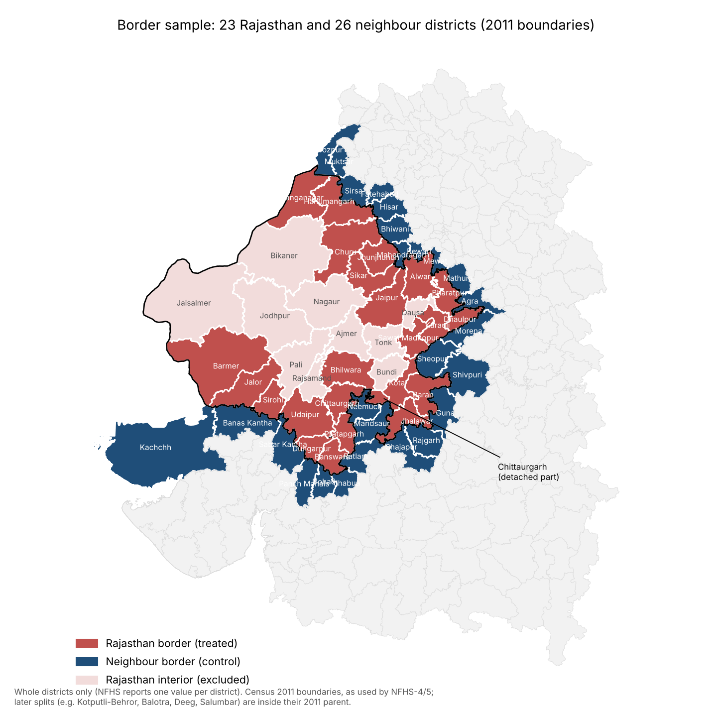

# Methodology: from start to end

**Cost side:** benefits can't be monetised (the OOP result is null), so the welfare
section is cost-effectiveness plus break-even, not a full CBA. Cost uses official
BSBY claims paid as a floor (the premium isn't public): at least about ₹377 per
additionally insured household per year. See `docs/presentation_guide.md`, section 12b.

---

## 1. Research question

**Did Rajasthan's state health insurance scheme raise coverage and reduce
households' out-of-pocket health spending, relative to comparable districts
just across the state border?**

- **Policy:** Bhamashah Swasthya Bima Yojana (BSBY), launched 13 Dec 2015.
  Cashless hospitalisation for ~1 crore poor families. Merged with Ayushman
  Bharat in 2019 as AB-MGRSBY.
- **Counterfactual:** neighbouring states (MP, Gujarat, Haryana, Punjab, UP) had
  the national RSBY and then PM-JAY (2018). The estimate is therefore
  *Rajasthan's scheme vs the national schemes*, not insurance vs no insurance.

## 2. How the topic was chosen

1. **PMUY (Ujjwala) all-India intensity DiD:** works, but the study needed a
   single-state focus (kept as appendix, `code/01`–`05`).
2. **PMUY within Rajasthan:** not identified. All 33 districts gained about the
   same, regardless of baseline (first-stage F ≈ 0.2).
3. **Search for a Rajasthan-only scheme with a border comparison:** Rajshri
   Yojana gave noisy, wrong-signed results. BSBY gave a large, robust coverage
   effect, so it was chosen.

## 3. Data (all public, direct download)

| File (`data/raw/`) | Content | Source |
|---|---|---|
| `nfhs_districts_641_kalla.csv` | NFHS-4 and NFHS-5, 641 districts, ~100 indicators | SaiSiddhardhaKalla/NFHS (IIPS factsheets) |
| `nfhs5_states_with_nfhs4.csv` | NFHS-4 and NFHS-5 by state | pratapvardhan/NFHS-5 |
| `nfhs4_states_ht.csv` | NFHS-4 by state, with NFHS-3 (2005-06) values | HindustanTimesLabs/nfhs-data |
| `map/2011_Dist.*` (downloaded by script) | Census 2011 district boundaries | datameet/maps |

**Data checks:**
- The district file matches a second source exactly (spot-checked Araria, Arwal and Patna).
- Districts created after NFHS-4 have their NFHS-4 value coded 0. These are
  treated as missing.
- 575 districts are comparable across rounds, which matches the DHS user forum count.

**Outcomes:**
- **Main:** households with any member covered by health insurance (%).
- **Welfare:** average OOP per delivery in a public facility (Rs), and its log.
- **Utilisation:** institutional births (%); births in public facilities (%).
- **Placebos** (should not respond to insurance): electricity (%); women with
  10+ years of schooling (%).

## 4. Border sample (`code/06a_border_pairs.py`)

1. **Load the Census 2011 district map.** NFHS-4 and NFHS-5 report the 2011
   districts (33 in Rajasthan), not the 2023/25 ones (41).
2. **Find touching districts:** every district in another state within 500 m of
   each Rajasthan district's boundary. The tolerance absorbs digitisation gaps.
3. **Measure the shared border length** to catch corner-only touches. The
   minimum is about 7 km, so there are no corner touches.
4. **Result:** 51 pairs; 23 Rajasthan and 26 neighbour districts.
5. **Join to NFHS on census state and district codes**, not names (spellings
   differ: "Panch Mahals" vs "Panchmahal").
6. **Drop five neighbour districts split after NFHS-4** (Panchmahal,
   Sabarkantha, Bhiwani, Shajapur, Firozpur). They have no comparable NFHS-4
   value. That leaves **40 pairs** in the regressions.

### Why some districts look partial on the map

Every district is used **whole**. NFHS gives one value per district, so a
partial district is impossible. Three things make the map look otherwise:

1. **2011 vs current boundaries.** Rajasthan split several districts in 2023.
   The study must use the 2011 parents:

   | 2011 district (used) | Now split into |
   |---|---|
   | Jaipur | Jaipur, Kotputli-Behror (part), Dudu |
   | Alwar | Alwar, Khairthal-Tijara, Kotputli-Behror (part) |
   | Bharatpur | Bharatpur, Deeg |
   | Barmer | Barmer, Balotra |
   | Udaipur | Udaipur, Salumbar |
   | Jodhpur / Nagaur / Ajmer | parts went to Phalodi, Didwana-Kuchaman, Beawar |

   This is why **Jaipur is a border district**: in 2011 it included the Kotputli
   area, which touches Haryana.
2. **Chittaurgarh is in two pieces.** Its detached part (about a quarter the
   size of the main block) lies near Kota, next to MP. Both pieces are coloured
   as Chittaurgarh.
3. **MP's Neemuch and Mandsaur cut deep into southern Rajasthan.** That blue
   wedge sits inside the Rajasthan outline. It's the state boundary that is
   irregular; the surrounding red districts are complete.

**Limitation:** districts are large (Barmer ≈ 28,000 km²), so this compares
border *districts*, not border *villages*. Sood et al. (2014) compare villages.
A GPS-based version is future work.

## 4b. Data cleaning and sanity checks (`code/00_clean_and_checks.py`)

The strategy was fixed before re-running any regression:

1. **Missing values (no imputation).** 0 is the factsheet code for suppressed
   (<25 cases) or non-comparable values, so 0 → missing. Districts split after
   NFHS-4 are dropped (structural). A test for differential missingness between
   Rajasthan and neighbours among comparable districts finds none (0/23 vs 0/21).
2. **Small-sample flags.** The 641-district file strips NFHS's ( ) marks for
   25–49-case estimates. They survive only in the pratapvardhan file (phase-1
   states). Of our border states only Gujarat is covered, with no flagged values.
3. **Sanity checks:** cross-source agreement (100% exact across two files;
   33/33 against the NFHS-6 compendium's NFHS-5 column), unique keys, ranges,
   public ≤ institutional births, large jumps listed for inspection, baseline balance.
4. **Outliers (OOP only).** Converted to real 2019-21 rupees with CPI-C (NFHS-4 ×1.209),
   then capped at Q3 + 1.5·IQR with fences per round over all comparable
   districts. The log outcome uses fences computed on the log scale.
   Percentages are bounded and left uncapped.
5. **Standardisation.** z = (x − μ)/σ with μ, σ from NFHS-4 neighbour border
   districts, applied to both rounds and sides. Scaling each round separately
   would erase the change the DiD measures.
6. **Leave-one-out.** Each pair, and each Rajasthan district with all its pairs,
   dropped in turn.

**Findings that changed the interpretation:**
- No border district reaches the OOP fence, so the OOP null is not outlier-driven.
- Rajasthan border districts had higher baseline OOP. Controlling for the
  NFHS-4 level flips the OOP estimate from −Rs 356 to +Rs 227 (n.s.): the
  negative point estimate was mean reversion.
- The OOP sign also depends on one district: dropping Baran moves it to +Rs 30.
  Insurance coverage is stable (+51.3 to +53.9) to every exclusion.

## 5. Main specification: border-pair DiD (`code/06_insurance_border.py`)

Following Dube, Lester & Reich (2010):

1. **Difference each district across rounds:**
   ΔY_d = Y_d(NFHS-5) − Y_d(NFHS-4). With two periods this equals a DiD with
   district fixed effects.
2. **Stack the pairs:** each pair contributes its Rajasthan district and its
   neighbour. A district bordering three neighbours appears three times.
3. **Regression:**

   ΔY_ip = β · Rajasthan_i + γ_p + ε_ip

   where γ_p is a pair fixed effect, so the comparison is only within each
   touching pair. β is the DiD.
4. **Standard errors:** two-way clustered by Rajasthan district and neighbour
   district, because districts repeat across pairs. Dube et al. cluster by state
   and border segment, but we have too few of those (6 states, 5 segments).
5. **Samples:**

   | Sample | Reason |
   |---|---|
   | All borders (40 pairs) | Main |
   | Drop Gujarat | Own state scheme (MA Yojana) since 2012 (cf. Karan et al. 2017) |
   | MP border only | MP had almost no RSBY enrolment by 2016 (Karan et al. 2017): cleanest control |
   | Pairs sharing ≥ 10 km | Drops short borders |

6. **Placebos (cf. Sood et al. 2014):** the same regression on electricity and
   women's schooling. A "Rajasthan effect" there would signal Rajasthan-wide
   divergence rather than insurance.

## 6. Pre-trend: three-round state event study

District data has only two rounds, so parallel trends are checked at state
level with NFHS-3.

| Insurance coverage (%) | 2005-06 | 2015-16 | 2019-21 |
|---|---|---|---|
| Rajasthan | 4.5 | 18.7 | 87.8 |
| Mean of 5 neighbours | ~5.9 | ~16.1 | ~28.8 |

- **φ2 (pre-period DiD, 2005→2016):** +4.1 pp. Roughly parallel.
- **φ3 (post-period DiD, 2016→2020):** +56.4 pp.
- **φ3 − φ2:** +52.3 pp (trend-adjusted; Karan et al. 2017 notation).
- **Permutation (Abadie et al. 2010; Conley & Taber 2011):** each of 27 states is
  "treated" in turn. Rajasthan's post-period gap ranks 1st of 27, so p = 1/27 ≈ 0.037. State names are harmonised across files; J&K and the merged DNH/Daman & Diu are dropped because their boundaries changed.

## 7. Results

| | Estimate | Reading |
|---|---|---|
| Insurance coverage | **+52.8 pp** (SE 5.1, p < 0.001); +45 to +52 across all samples | Very large coverage effect |
| OOP per delivery | −Rs 253 (SE 702), n.s. | No detectable financial protection on deliveries |
| Institutional births | −1.2 pp, n.s. | No change in use |
| Placebo: electricity | +3.2, n.s. | Passes |
| Placebo: women's schooling | +3.1, p = 0.08 | Borderline; report it |
| State event study | Parallel, then 1st of 27 | Supports the design |

**Why OOP may not fall:** public-facility deliveries were already nearly free
under JSY, so there was little to cut. This is consistent with Karan, Yip & Mahal
(2017), who find RSBY did not reduce OOP.

## 8. Limitations

1. **Contaminated baseline:** Rajasthan's NFHS-4 fieldwork ran 23 Jan – 21 Jul
   2016, after the launch, so β is a **lower bound**.
2. **Comparison is scheme vs scheme:** BSBY/AB-MGRSBY against RSBY/PM-JAY.
3. **District averages:** eligible and ineligible households can't be
   separated, so there's no triple difference.
4. **Nominal OOP:** inflation that is common to both sides of a pair cancels.
5. **OOP covers deliveries only:** a narrow measure. NSS health rounds would be
   better (future work).
6. **No spatial RDD:** that needs household GPS (DHS) data (future work; Dell
   2010, Sood et al. 2014).

## 9. Files

| File | Purpose |
|---|---|
| `code/06a_border_pairs.py` | 51 pairs from the map; `fig_border_map.png` |
| `code/06_insurance_border.py` | Border DiD, placebos, state event study, permutation |
| `output/insurance/border_pair_did.csv` | All regression estimates |
| `output/insurance/state_event_study.txt` | φ2, φ3, permutation |
| `output/insurance/fig_state_event_study.png` | Three-round chart |
| `docs/literature.md` | References |
